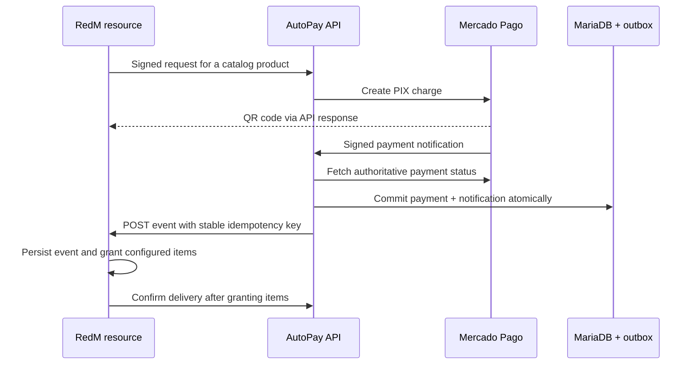

# AutoPay RedM

Automatic PIX payment processing and in-game fulfillment integration for RedM servers.

Built by **Werley Filho (Novak)** to connect a game store to a payment provider: create a charge, verify its payment, notify the game server and track item delivery. This public edition contains the API and administration panel, with fictional configuration examples and an independent Git history.

## What the system does

- Creates PIX charges through Mercado Pago, with idempotency keys and server-side catalog prices.
- Validates signed payment webhooks and checks the current payment with the provider.
- Updates payment state and queues the game notification in one database transaction.
- Retries notifications when the game server is unavailable, preserving event order per charge.
- Exposes pending deliveries so the RedM resource can fulfill purchases after a player reconnects.
- Provides an administration panel for products, item rewards, boxes, coupons, customers and transaction history.



The game-specific Lua inventory/resource code is not included. This repository provides its integration contract; it does not claim that a standalone API can grant inventory items without a RedM receiver. Legacy internal `fivem*` names remain in some modules because RedM and FiveM share the Cfx.re ecosystem. Public configuration uses `REDM_*`.

## Stack

| Component | Technologies |
| --- | --- |
| API | Node.js 22+, TypeScript, Express, Zod, official Mercado Pago SDK |
| Persistence | MariaDB 11.4+, InnoDB transactions, parameterized SQL |
| Administration | Next.js, React, TypeScript, Tailwind CSS |
| Tests | Node test runner, HTTP fixtures and isolated database integration tests |

## Run checks without payment credentials

```sh
cd external-api
npm ci --ignore-scripts
npm test
npm run build
cd ../admin-panel
npm ci --ignore-scripts
npm run build
```

HTTP tests bind to loopback and use synthetic payment data. The database test is skipped locally unless explicitly enabled; It was also run against an isolated local MariaDB service. A sample pipeline is included in `docs/ci-workflow.example.yml`. Tests never approve real payments or contact the payment provider.

## Local setup

1. Create a dedicated MariaDB database and an application user restricted to it. Do not point a portfolio instance at an existing game database.
2. Copy `external-api/.env.example` to `external-api/.env`. Replace every placeholder with local values. Use the provider's sandbox credentials for local integration work.
3. Generate separate random values for `SERVICE_TOKEN`, `SERVICE_HMAC_SECRET`, `ADMIN_JWT_SECRET` and `REDM_CALLBACK_TOKEN`:

   ```sh
   node -e "console.log(require('node:crypto').randomBytes(32).toString('hex'))"
   ```

4. Copy `admin-panel/.env.example` to `admin-panel/.env.local`. Its server-only `ADMIN_JWT_SECRET` must match the API's value. No secret belongs in a `NEXT_PUBLIC_*` variable.
5. In `external-api`, run `npm ci`, `npm run build`, then `npm start`. The API binds to `127.0.0.1:8085` by default and initializes its dedicated tables.
6. Create the first administrator with `npm run admin`. In another terminal, run the panel with `npm run dev` from `admin-panel`; open `http://localhost:3001/login`.
7. Configure an HTTPS webhook URL yourself in Mercado Pago. Startup never opens a tunnel or kills existing processes.
8. Implement the [RedM integration contract](docs/redm-integration.md) before configuring `REDM_CALLBACK_URL`.

Placeholders intentionally fail validation. There is no shared public administrator account, live token, or payment-approval simulation endpoint.

## Design and operational boundaries

- Notifications are delivered **at least once**. The game receiver must deduplicate by `eventKey` and handle inventory updates transactionally; an HTTP timeout does not prove that items were not granted.
- Acknowledging a notification and confirming item delivery are distinct operations. Mark delivery only after the inventory operation succeeds.
- The payment webhook accepts signed `payment` notifications for the Payments API. Other Mercado Pago notification families and unsigned QR merchant-order notifications require a separate adapter.
- The callback contract in this edition uses authenticated POST JSON. It is not a drop-in replacement for legacy GET/base64 callback resources.
- Refunds and chargebacks are notified separately; the server owner defines the corresponding inventory/reversal policy.
- Access tokens expire after 15 minutes. Logout revokes the refresh token; an already-issued access token can remain valid until expiration. Disabled accounts are checked on protected API access.
- Run behind HTTPS and a deliberately configured reverse proxy. Database migrations are intended for this edition's dedicated database.

See [security practices](SECURITY.md) and the [validation record](docs/validation.md). This is a portfolio edition, not a claim of production certification.
